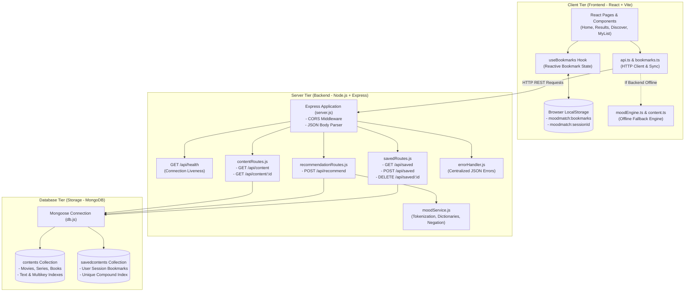
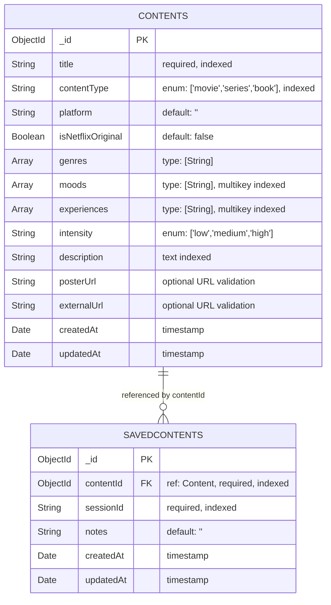
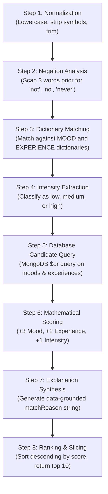
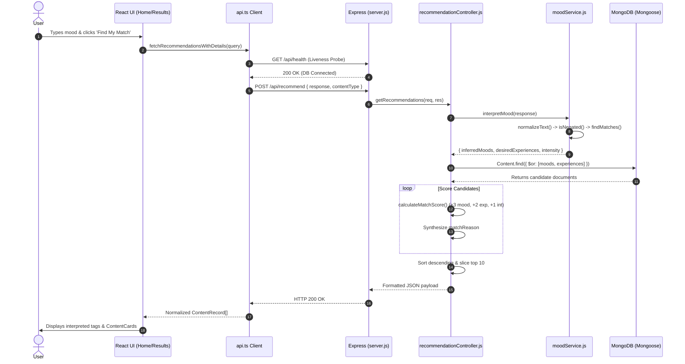
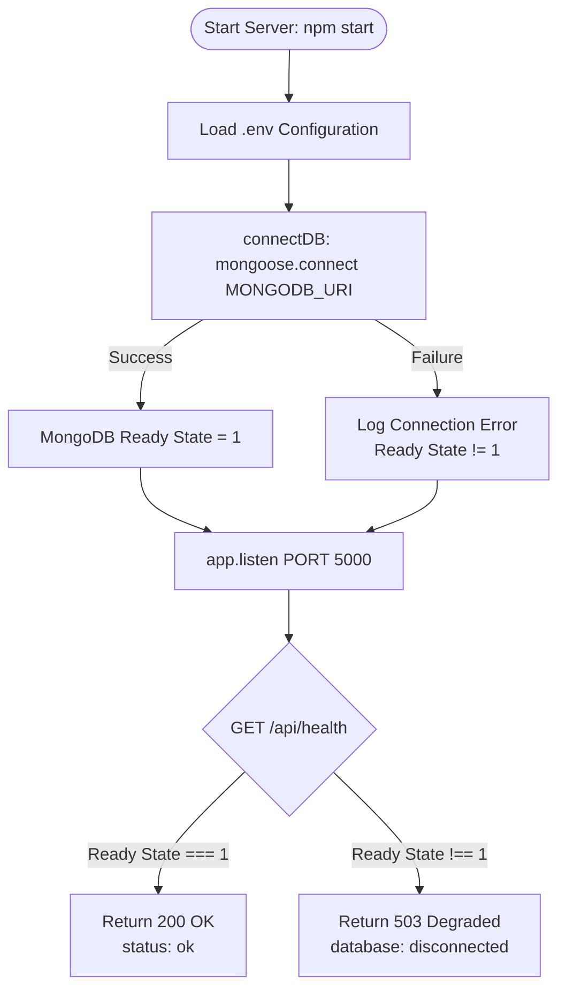

# MoodMatch: Full-Stack Mood-Based Content Recommendation Platform

> **A comprehensive technical architecture guide, code documentation, and academic study companion for the MoodMatch project.**  
> *Developed for the JavaScript Framework (PBL) Course Evaluation at ITM SLS Baroda University, Department of Computer Science & Engineering.*

---

## 🚀 "Explain MoodMatch in 2 Minutes" (Project Defense Summary)

> **Use this concise, high-impact script during your project demonstration and viva evaluation:**

> "Good morning, respected faculty. Today, I am presenting **MoodMatch**, a full-stack JavaScript web platform designed to solve **content choice paralysis**.
>
> On conventional streaming platforms, users are trapped in rigid genre dropdowns like 'Action' or 'Drama' that fail to capture how they actually feel. Users know their mood, but they struggle to find titles that match their emotional energy.
>
> **MoodMatch** allows users to express themselves in everyday natural language—such as *'I had a stressful day and want something comforting and funny'*.
>
> Our architecture consists of three decoupled layers:
> 1. **Frontend:** Built with **React 18, Vite 5, TypeScript 5, and Tailwind CSS**, featuring declarative client-side routing via **React Router DOM v6**.
> 2. **Backend:** Built with **Node.js and Express.js v5**, exposing RESTful JSON endpoints for content retrieval, mood interpretation, and bookmark management.
> 3. **Database:** Powered by **MongoDB** with **Mongoose v9 ODM**, storing movies, TV series, and books categorized with multikey mood and experience indexes.
>
> **How our recommendation algorithm works:**  
> Our algorithm is **100% deterministic, transparent, and rule-based—it does NOT rely on black-box AI or heavy machine learning**. When text arrives at `POST /api/recommend`, our backend service normalizes the input, scans for negation patterns like *'not sad'*, and matches tokens against curated mood and experience dictionaries. It then queries MongoDB and scores candidate titles using a formula: **+3 points** for mood matches, **+2 points** for desired experience matches, and **+1 point** for intensity alignment. The top ten ranked results are returned alongside a data-grounded explanation (e.g., *'Matches your requested comfort experience and stressed mood'*).
>
> **Key Engineering Highlights:**
> - **Dual-Mode Fault Tolerance:** If the MongoDB server or Express backend goes down, the React frontend automatically detects the outage and falls back to a bundled 28-record local dataset and client-side rule engine without breaking the user experience.
> - **Dual-Synced Bookmarking:** The 'My List' feature provides instant optimistic UI updates via browser `localStorage` while synchronizing saved items to MongoDB using anonymous session IDs.
> - **Automated Test Coverage:** The backend includes a 64-assertion automated test suite (`npm test`) covering negation parsing, scoring accuracy, HTTP status codes, and duplicate save prevention.
>
> Thank you, and I look forward to demonstrating our working application."

---

## 📑 Table of Contents

- [1. Project Overview & Architecture](#1-project-overview--architecture)
  - [1.1 Problem Statement](#11-problem-statement)
  - [1.2 Proposed Solution & Philosophy](#12-proposed-solution--philosophy)
  - [1.3 Core Implemented Features](#13-core-implemented-features)
  - [1.4 System Architecture & Component Responsibilities](#14-system-architecture--component-responsibilities)
  - [1.5 Complete Request-Response Lifecycle](#15-complete-request-response-lifecycle)
  - [1.6 System Architecture Diagram](#16-system-architecture-diagram)
- [2. Complete Project Directory Structure](#2-complete-project-directory-structure)
  - [2.1 High-Level Directory Tree](#21-high-level-directory-tree)
  - [2.2 Grouped & Generated Files Explanation](#22-grouped--generated-files-explanation)
  - [2.3 Exhaustive File-by-File Breakdown Table](#23-exhaustive-file-by-file-breakdown-table)
- [3. In-Depth Frontend Source Code Analysis](#3-in-depth-frontend-source-code-analysis)
  - [3.1 Entry Point & Root Setup (`main.tsx`, `App.tsx`)](#31-entry-point--root-setup-maintsx-apptsx)
  - [3.2 Shared Types & Domain Models (`types.ts`)](#32-shared-types--domain-models-typests)
  - [3.3 Application Pages (`Home`, `Results`, `Discover`, `ContentDetail`, `MyList`)](#33-application-pages-home-results-discover-contentdetail-mylist)
  - [3.4 Reusable UI Components (`Navbar`, `Footer`, `ContentCard`, `States`)](#34-reusable-ui-components-navbar-footer-contentcard-states)
  - [3.5 Frontend Services & API Layer (`api.ts`, `bookmarks.ts`, `moodEngine.ts`)](#35-frontend-services--api-layer-apits-bookmarksts-moodenginets)
  - [3.6 Custom Hooks (`useBookmarks.ts`)](#36-custom-hooks-usebookmarksts)
  - [3.7 Bundled Catalog Dataset (`data/content.ts`)](#37-bundled-catalog-dataset-datacontentts)
  - [3.8 Styling & Build Configuration (`index.css`, `tailwind.config.js`, `vite.config.ts`)](#38-styling--build-configuration-indexcss-tailwindconfigjs-viteconfigts)
- [4. In-Depth Backend Source Code Analysis](#4-in-depth-backend-source-code-analysis)
  - [4.1 Server Entry Point & Middleware Pipeline (`server.js`)](#41-server-entry-point--middleware-pipeline-serverjs)
  - [4.2 Database Configuration & Connection Handler (`config/db.js`)](#42-database-configuration--connection-handler-configdbjs)
  - [4.3 Express Routers (`contentRoutes.js`, `recommendationRoutes.js`, `savedRoutes.js`)](#43-express-routers-contentroutesjs-recommendationroutesjs-savedroutesjs)
  - [4.4 Controllers (`contentController.js`, `recommendationController.js`, `savedController.js`)](#44-controllers-contentcontrollerjs-recommendationcontrollerjs-savedcontrollerjs)
  - [4.5 Mood Interpretation Service (`services/moodService.js`)](#45-mood-interpretation-service-servicesmoodservicejs)
  - [4.6 Centralized Error Handling (`middleware/errorHandler.js`)](#46-centralized-error-handling-middlewareerrorhandlerjs)
  - [4.7 Database Seeding & Verification Scripts (`scripts/seed.js`, `scripts/verify-schema.js`)](#47-database-seeding--verification-scripts-scriptsseedjs-scriptsverify-schemajs)
  - [4.8 Automated Test Suite (`test.js`)](#48-automated-test-suite-testjs)
- [5. Database Architecture & Data Modeling](#5-database-architecture--data-modeling)
  - [5.1 MongoDB & Mongoose Configuration](#51-mongodb--mongoose-configuration)
  - [5.2 `Content` Schema & Indexing Strategy](#52-content-schema--indexing-strategy)
  - [5.3 `SavedContent` Schema & Duplicate Prevention](#53-savedcontent-schema--duplicate-prevention)
  - [5.4 Entity-Relationship (ER) Diagram](#54-entity-relationship-er-diagram)
  - [5.5 Data Persistence: MongoDB vs. LocalStorage Comparison](#55-data-persistence-mongodb-vs-localstorage-comparison)
- [6. The Recommendation Engine: Detailed Breakdown](#6-the-recommendation-engine-detailed-breakdown)
  - [6.1 Algorithm Philosophy: Rule-Based vs. Machine Learning](#61-algorithm-philosophy-rule-based-vs-machine-learning)
  - [6.2 The 8-Step Recommendation Pipeline](#62-the-8-step-recommendation-pipeline)
  - [6.3 Curated Dictionaries: Moods, Experiences & Negation Tokens](#63-curated-dictionaries-moods-experiences--negation-tokens)
  - [6.4 Mathematical Scoring Model](#64-mathematical-scoring-model)
  - [6.5 Complete Worked Example (Step-by-Step Calculation)](#65-complete-worked-example-step-by-step-calculation)
- [7. Complete Feature Execution Workflows](#7-complete-feature-execution-workflows)
  - [7.1 Workflow 1: Natural Language Mood Recommendation](#71-workflow-1-natural-language-mood-recommendation)
  - [7.2 Workflow 2: Catalog Browsing, Debounced Search & Filtering](#72-workflow-2-catalog-browsing-debounced-search--filtering)
  - [7.3 Workflow 3: Content Detail View & Related Content Recommendations](#73-workflow-3-content-detail-view--related-content-recommendations)
  - [7.4 Workflow 4: Bookmark Management & 'My List' Synchronization](#74-workflow-4-bookmark-management--my-list-synchronization)
  - [7.5 Workflow 5: Automatic Offline Fallback Execution](#75-workflow-5-automatic-offline-fallback-execution)
- [8. REST API Endpoint Reference](#8-rest-api-endpoint-reference)
- [9. Dependencies, Packages & Configuration](#9-dependencies-packages--configuration)
  - [9.1 Frontend Dependencies](#91-frontend-dependencies)
  - [9.2 Backend Dependencies](#92-backend-dependencies)
  - [9.3 Configuration Files & Environment Variables](#93-configuration-files--environment-variables)
- [10. Setup, Installation & How to Run](#10-setup-installation--how-to-run)
  - [10.1 Prerequisites](#101-prerequisites)
  - [10.2 Step-by-Step Installation](#102-step-by-step-installation)
  - [10.3 Database Seeding & Verification](#103-database-seeding--verification)
  - [10.4 Running the Automated Test Suite](#104-running-the-automated-test-suite)
  - [10.5 Development Mode vs. Production Build](#105-development-mode-vs-production-build)
  - [10.6 Troubleshooting Common Issues](#106-troubleshooting-common-issues)
- [11. Security Audit & Known Limitations](#11-security-audit--known-limitations)
  - [11.1 Security Implementation Analysis](#111-security-implementation-analysis)
  - [11.2 Inherent System Limitations](#112-inherent-system-limitations)
  - [11.3 Code vs. Documentation Discrepancies](#113-code-vs-documentation-discrepancies)
- [12. Mermaid Visual Diagrams](#12-mermaid-visual-diagrams)
- [13. Viva Preparation: 35 Questions & Comprehensive Answers](#13-viva-preparation-35-questions--comprehensive-answers)

---

## 1. Project Overview & Architecture

### 1.1 Problem Statement
Modern entertainment consumers have access to millions of hours of streaming content across platforms like Netflix, Prime Video, Apple TV+, and digital book libraries. Despite this abundance, users frequently experience **choice paralysis** (the inability to decide what to watch or read).

Traditional recommendation systems fail users in three specific ways:
1. **Rigid Genre Pigeonholing:** Classifications such as *"Action"* or *"Comedy"* are too broad. A user feeling burned out after exams might want a comedy, but specifically an easy-watching, wholesome comedy (like *The Great British Bake Off* or *Ted Lasso*), not a dark, cynical satire.
2. **Black-Box Collaborative Filtering:** Systems recommend items because *"users like you watched this"*, rather than addressing the user's immediate emotional and psychological state.
3. **Friction-Heavy Questionnaires:** Lengthy onboarding forms and mood sliders create friction when a user simply wants a fast suggestion.

### 1.2 Proposed Solution & Philosophy
**MoodMatch** introduces an intuitive, text-first recommendation interface where users describe their mood or desired atmosphere in natural language.

**Core Philosophy: Explainable, Deterministic Rules (NOT AI/ML):**
MoodMatch deliberately rejects black-box AI and heavy machine learning in favor of an **open, verifiable, rule-based keyword mapping architecture**.
- **Transparent:** The user is shown exactly why an item was chosen (e.g., *"Matches your requested comfort experience and stressed mood"*).
- **Fast:** Inference takes under 5 milliseconds with zero external API latency or token costs.
- **Predictable:** Negation handling (*"I am not sad"*) is deterministic and easily tested using unit tests.

### 1.3 Core Implemented Features
1. **Natural-Language Mood Textarea:** Interactive input on the Home page with inspirational chips and live word counter.
2. **Dual-Dictionary Mood Parser:** Extracts primary emotions and desired narrative experiences while respecting negation tokens.
3. **Multi-Media Catalog:** Curated recommendations spanning **Books, Movies, and TV Series**.
4. **Relevance Scoring Engine:** Mathematically ranks candidates and produces human-readable match justifications.
5. **Catalog Discovery:** Search bar with 250ms debouncing, combined with multi-attribute filtering by content type, intensity, genre, and mood.
6. **Detailed Content Pages:** Dedicated routes (`/content/:id`) displaying synopses, intensity levels, platform availability, and outbound reference links.
7. **Dual-Persistence "My List":** Instant client-side bookmarking in `localStorage` synchronized with MongoDB via session headers.
8. **Fault-Tolerant Offline Fallback:** Automatic health detection that transparently switches to local dataset and client-side scoring if the backend is offline.
9. **Automated Testing Suite:** 64 automated backend assertions validating health probes, queries, scoring, and duplicate protections.

### 1.4 System Architecture & Component Responsibilities

The application follows a decoupled client-server architecture:

```
+-----------------------------------------------------------------------------------+
|                                CLIENT TIER (Browser)                             |
|  React 18  *  Vite 5  *  TypeScript 5  *  Tailwind CSS  *  React Router DOM v6   |
+-----------------------------------------------------------------------------------+
                                       |
                   HTTP REST API (JSON) via Browser Fetch
                                       |
+-----------------------------------------------------------------------------------+
|                                SERVER TIER (Node.js)                             |
|  Express.js v5  *  CORS  *  Custom Middleware  *  Rule-Based Mood Engine          |
+-----------------------------------------------------------------------------------+
                                       |
                   Mongoose v9 Object Data Modeling (ODM)
                                       |
+-----------------------------------------------------------------------------------+
|                              DATABASE TIER (Storage)                             |
|  MongoDB Community Server (Local)  OR  MongoDB Atlas M0 Free Cluster (Cloud)      |
+-----------------------------------------------------------------------------------+
```

#### Tier Responsibilities
- **Frontend (Client):** Manages user interaction, view routing, visual states (loading skeletons, empty states, error alerts), local caching of bookmarks in `localStorage`, and client-side fallback recommendation logic.
- **Backend (Server):** Exposes REST routes, sanitizes incoming query parameters, validates JSON payloads, executes the rule-based mood interpretation engine, calculates match scores, and formats standardized JSON responses.
- **Database (Persistence):** Enforces data schema integrity, runs field validations, maintains compound and multikey indexes, and guarantees unique session-content bookmark relationships.

### 1.5 Complete Request-Response Lifecycle

Here is how data flows from the user's keystrokes to the database and back:

1. **User Action:** The user types *"I feel overwhelmed and want something cozy"* into `Home.tsx` and clicks **Find My Match**.
2. **Navigation:** React Router transitions the user to `/results`, passing `{ state: { query: text } }`.
3. **Frontend Service Dispatch:** `Results.tsx` calls `fetchRecommendationsWithDetails(query)` in `api.ts`.
4. **Backend Health Check:** `api.ts` verifies backend reachability via `GET /api/health`. If reachable, it issues `POST /api/recommend` with `{ response: text, contentType: 'all' }`.
5. **Express Routing:** The request hits `server.js`, passes through `cors()`, `express.json()`, and routes to `recommendationRoutes.js`.
6. **Controller Execution:** `recommendationController.js` validates payload length and type, then forwards the text to `moodService.js`.
7. **Mood Interpretation:** `moodService.js` normalizes text, scans for negation words, and matches tokens against `MOOD_DICTIONARY` (`stressed`) and `EXPERIENCE_DICTIONARY` (`comfort`).
8. **Database Query:** The controller issues a Mongoose `$or` query against the `contents` collection in MongoDB for items tagged with `stressed` or `comfort`.
9. **Scoring & Ranking:** Each candidate is scored via `calculateMatchScore()`. Items are sorted descending by score, and the top 10 items are selected.
10. **JSON Response:** Express sends back HTTP `200 OK` with `{ inferredMoods, desiredExperiences, intensity, recommendations }`.
11. **UI Rendering:** `Results.tsx` receives the data, updates state, and renders `ContentCard.tsx` elements with badges and data-grounded match notes.

### 1.6 System Architecture Diagram



---

## 2. Complete Project Directory Structure

### 2.1 High-Level Directory Tree

```text
MoodMatch/
├── .dist/                              # Build cache directory
├── .git/                               # Git version control metadata
├── .gitignore                          # Root Git ignore rules
├── package.json                        # Root npm script orchestrator
├── README.md                           # Master technical documentation
├── MOODMATCH_PROJECT_VERIFICATION.md   # Project verification & test audit report
│
├── frontend/                           # React 18 + Vite 5 Client Application
│   ├── .env                            # Frontend local environment config
│   ├── .env.example                    # Frontend environment template
│   ├── .gitignore                      # Frontend-specific Git ignore rules
│   ├── .gitkeep                        # Git placeholder
│   ├── dist/                           # Compiled production build assets
│   ├── eslint.config.js                # ESLint flat configuration
│   ├── index.html                      # Single-page application HTML entry
│   ├── node_modules/                   # Frontend installed dependencies
│   ├── package.json                    # Frontend dependencies and npm scripts
│   ├── package-lock.json               # Locked frontend dependency tree
│   ├── postcss.config.js               # PostCSS plugin setup (Tailwind/Autoprefixer)
│   ├── tailwind.config.js              # Tailwind design tokens and custom palette
│   ├── tsconfig.json                   # Root TypeScript project references
│   ├── tsconfig.app.json               # Application-level TypeScript settings
│   ├── tsconfig.node.json              # Vite/Node TypeScript settings
│   ├── vite.config.ts                  # Vite bundler plugins and path aliases
│   └── src/                            # Frontend application source code
│       ├── main.tsx                    # React DOM root render entry point
│       ├── App.tsx                     # Top-level router and layout shell
│       ├── index.css                   # Tailwind imports, custom font & utilities
│       ├── types.ts                    # Shared TypeScript interfaces & types
│       ├── vite-env.d.ts               # Vite client type declarations
│       ├── components/                 # Reusable presentational components
│       │   ├── Navbar.tsx              # Sticky navigation bar with mobile drawer
│       │   ├── Footer.tsx              # Application footer with metadata notes
│       │   ├── ContentCard.tsx         # Media card with cover art & bookmark toggle
│       │   └── States.tsx              # Loading, Error, Empty & Skeleton views
│       ├── pages/                      # Routed screen views
│       │   ├── Home.tsx                # Hero section, mood textarea & example chips
│       │   ├── Results.tsx             # Mood interpretation breakdown & recommendations
│       │   ├── Discover.tsx            # Multi-attribute search and catalog filtering
│       │   ├── ContentDetail.tsx       # Detailed title view & related suggestions
│       │   └── MyList.tsx              # Saved bookmarks view with category tabs
│       ├── services/                   # Business logic & API clients
│       │   ├── api.ts                  # Backend REST API client & offline fallback
│       │   ├── bookmarks.ts            # LocalStorage & MongoDB bookmark synchronization
│       │   └── moodEngine.ts           # Client-side rule-based mood interpreter
│       ├── hooks/                      # Custom React hooks
│       │   └── useBookmarks.ts         # Reactive bookmark state synchronization hook
│       └── data/                       # Bundled offline dataset
│           └── content.ts              # 28 curated books, movies, and series records
│
└── backend/                            # Node.js + Express 5 Server Application
    ├── .dist/                          # Backend build cache
    ├── .env                            # Backend local environment config
    ├── .env.example                    # Backend environment template
    ├── .gitignore                      # Backend Git ignore rules
    ├── package.json                    # Backend dependencies and npm scripts
    ├── package-lock.json               # Locked backend dependency tree
    ├── server.js                       # Express app configuration & server starter
    ├── seed.js                         # Root legacy seeder script
    ├── test.js                         # Automated 64-assertion backend test suite
    ├── config/                         # Infrastructure configuration
    │   └── db.js                       # Mongoose MongoDB connection routine
    ├── controllers/                    # HTTP request handlers
    │   ├── contentController.js        # Content query, filter, search, detail logic
    │   ├── recommendationController.js # Recommendation scoring & ranking logic
    │   └── savedController.js          # Saved content CRUD operations
    ├── routes/                         # Express route definitions
    │   ├── contentRoutes.js            # /api/content endpoints
    │   ├── recommendationRoutes.js     # /api/recommend endpoints
    │   └── savedRoutes.js              # /api/saved endpoints
    ├── services/                       # Server-side business logic
    │   └── moodService.js              # Mood inference, dictionaries, negation parser
    ├── middleware/                     # Express middleware functions
    │   └── errorHandler.js             # Centralized JSON error & 404 handlers
    ├── models/                         # Mongoose data schemas
    │   ├── Content.js                  # Schema for books, movies, series
    │   └── SavedContent.js             # Schema for session saved items
    ├── scripts/                        # Database management utilities
    │   ├── seed.js                     # Idempotent database seeder (upsert)
    │   └── verify-schema.js            # Standalone offline schema constraint verifier
    └── data/                           # Curated backend seed dataset
        └── sampleContent.js            # 14 curated content records
```

### 2.2 Grouped & Generated Files Explanation
- **`node_modules/` (in root, frontend, backend):** Installed third-party packages managed by npm. Never committed to version control; installed via `npm install`.
- **`package-lock.json`:** Cryptographic dependency trees generated by npm ensuring deterministic installs across developer machines.
- **`dist/` & `.dist/`:** Output directories generated during build compilation (`npm run build`). Contains minified chunks and assets for production.
- **`.env` files:** Local environment configurations storing port numbers and connection strings. Excluded by `.gitignore` to prevent secret leakage.

### 2.3 Exhaustive File-by-File Breakdown Table

| Relative File Path | Purpose | Why It Exists | Key Exports / Functions | Interactions | Role |
| :--- | :--- | :--- | :--- | :--- | :--- |
| `package.json` | Root workspace script orchestrator | Provides convenient top-level commands | `npm start`, `npm run dev`, `npm test`, `npm run seed` | Delegates commands via `--prefix backend` | Configuration |
| `frontend/src/main.tsx` | React DOM mount entry | Bootstraps React into DOM `#root` | `createRoot().render()` | Mounts `App.tsx` wrapped in `StrictMode` | Production |
| `frontend/src/App.tsx` | Root router component | Defines URL routes and main layout | `App()` | Uses `Navbar`, `Footer`, and page components | Production |
| `frontend/src/types.ts` | Domain type declarations | Enforces compile-time type safety | `ContentType`, `Intensity`, `ContentRecord`, `MoodInterpretation` | Imported by all frontend pages and services | Development |
| `frontend/src/pages/Home.tsx` | Landing & mood input screen | Allows user to input feeling text | `Home()` component | Navigates to `/results` with query state | Production |
| `frontend/src/pages/Results.tsx` | Results & explanation view | Displays interpreted mood & cards | `Results()` component | Calls `fetchRecommendationsWithDetails()` | Production |
| `frontend/src/pages/Discover.tsx` | Catalog search & filter screen | Multi-attribute exploration | `Discover()` component | Calls `fetchFiltered()`, uses `ALL_GENRES` | Production |
| `frontend/src/pages/ContentDetail.tsx` | Single title metadata view | In-depth synopsis & outbound link | `ContentDetail()` component | Calls `fetchContentById()`, `useBookmarks` | Production |
| `frontend/src/pages/MyList.tsx` | Saved items collection screen | Displays user's bookmarks | `MyList()` component | Consumes `useBookmarks` hook | Production |
| `frontend/src/components/Navbar.tsx` | Top header navigation | Navigation and mobile menu | `Navbar()` component | Links to `/`, `/discover`, `/my-list` | Production |
| `frontend/src/components/Footer.tsx` | Application footer | Attribution and academic notes | `Footer()` component | Rendered on all pages via `App.tsx` | Production |
| `frontend/src/components/ContentCard.tsx` | Standardized media item card | Renders poster, title, tags, save button | `ContentCard()` component | Links to `/content/:id`, toggles bookmarks | Production |
| `frontend/src/components/States.tsx` | UI feedback components | Consistent visual feedback | `LoadingState`, `ErrorState`, `EmptyState`, `CardSkeleton` | Rendered across all page states | Production |
| `frontend/src/services/api.ts` | API client & fallback bridge | Fetches from backend or falls back | `checkBackend()`, `fetchAllContent()`, `fetchRecommendationsWithDetails()` | Calls Express backend via `fetch` | Production |
| `frontend/src/services/bookmarks.ts` | Bookmark storage synchronization | Syncs `localStorage` & `/api/saved` | `getSessionId()`, `getBookmarks()`, `toggleBookmark()` | Interfaces with browser storage & API | Production |
| `frontend/src/services/moodEngine.ts` | Client-side rule interpreter | Fallback offline recommendation engine | `interpretMood()`, `scoreContent()`, `MOOD_RULES` | Consumed when backend is unreachable | Production |
| `frontend/src/hooks/useBookmarks.ts` | Reactive bookmark hook | Syncs components with bookmark events | `useBookmarks()` hook | Listens for `bookmark-changed` DOM events | Production |
| `frontend/src/data/content.ts` | Bundled 28-record catalog | Guarantees UI works offline | `CONTENT`, `ALL_MOODS`, `ALL_GENRES` | Used by `api.ts` when backend is down | Production |
| `frontend/tailwind.config.js` | Tailwind CSS configuration | Custom color palette & fonts | Theme extensions (`lavender`, `blush`, `cream`) | Processed by PostCSS | Configuration |
| `frontend/vite.config.ts` | Vite bundler setup | Configures dev server & `@` alias | Vite plugins, path resolve | Configures build pipeline | Configuration |
| `backend/server.js` | Express server entry point | Initializes HTTP app & middleware | `app`, `connectDB()`, `startServer()` | Mounts routers and error handlers | Production |
| `backend/config/db.js` | Database connection handler | Connects Mongoose to MongoDB URI | `connectDB()` | Reads `process.env.MONGODB_URI` | Production |
| `backend/models/Content.js` | Content Mongoose model | Schema for movies, series, books | `Content` model | Defines validation rules and indexes | Production |
| `backend/models/SavedContent.js` | Saved item Mongoose model | Schema for session bookmarks | `SavedContent` model | Defines unique compound session index | Production |
| `backend/routes/contentRoutes.js` | Content route definitions | Maps `/api/content` URLs | Express `Router` | Routes to `contentController.js` | Production |
| `backend/routes/recommendationRoutes.js` | Recommendation route definition | Maps `/api/recommend` URL | Express `Router` | Routes to `recommendationController.js` | Production |
| `backend/routes/savedRoutes.js` | Saved content route definitions | Maps `/api/saved` URLs | Express `Router` | Routes to `savedController.js` | Production |
| `backend/controllers/contentController.js` | Content business logic | Filtering, search, pagination, detail | `getContentList()`, `getContentById()` | Queries Mongoose `Content` model | Production |
| `backend/controllers/recommendationController.js` | Recommendation scoring logic | Scores & ranks candidates | `getRecommendations()`, `calculateMatchScore()` | Calls `moodService.js`, queries MongoDB | Production |
| `backend/controllers/savedController.js` | Bookmark CRUD logic | Manages session saved items | `saveContent()`, `getSavedContent()`, `removeSavedContent()` | Queries `SavedContent`, populates content | Production |
| `backend/services/moodService.js` | Mood inference engine | Parses words, negation, intensity | `interpretMood()`, `findMatches()`, `isNegated()` | Consumed by `recommendationController` | Production |
| `backend/middleware/errorHandler.js` | Global error middleware | Formats uniform JSON errors | `errorHandler()`, `notFoundHandler()` | Catches errors from all routes | Production |
| `backend/scripts/seed.js` | Idempotent database seeder | Seeds 14 records without duplicates | `seedDatabase()` | Uses `findOneAndUpdate` with upsert | Database Utility |
| `backend/scripts/verify-schema.js` | Offline schema tester | Validates dataset without live DB | CLI validation script | Verifies 14 records against schema | Testing Utility |
| `backend/test.js` | Comprehensive test runner | 64-assertion automated test suite | `runTests()` | Sets up in-memory mock and tests API | Testing |
| `backend/data/sampleContent.js` | Curated database records | 14 seed items (5 books, 5 movies, 4 series) | `sampleContents` array | Imported by seed and verifier scripts | Production/Test |

---

## 3. In-Depth Frontend Source Code Analysis

### 3.1 Entry Point & Root Setup (`main.tsx`, `App.tsx`)
- **`main.tsx` (`frontend/src/main.tsx`):**  
  Uses React 18's `createRoot` API to mount the application into the `#root` `div` of `index.html`. It wraps `<App />` inside `<StrictMode>`, enabling runtime checks and warnings during development.
- **`App.tsx` (`frontend/src/App.tsx`):**  
  The root component wrapped in `<BrowserRouter>` from `react-router-dom`. It establishes a responsive flex-column container (`min-h-screen bg-cream-50`) and renders `<Navbar />` at the top, a dynamic `<Routes>` container in `<main>`, and `<Footer />` at the bottom.
  
  ```tsx
  <Routes>
    <Route path="/" element={<Home />} />
    <Route path="/results" element={<Results />} />
    <Route path="/discover" element={<Discover />} />
    <Route path="/content/:id" element={<ContentDetail />} />
    <Route path="/my-list" element={<MyList />} />
    <Route path="*" element={<Home />} />
  </Routes>
  ```

### 3.2 Shared Types & Domain Models (`types.ts`)
Located at `frontend/src/types.ts`, this file defines the core TypeScript contracts:
- `ContentType = 'book' | 'movie' | 'series'`
- `Intensity = 'light' | 'moderate' | 'intense'`
- `ContentRecord`: Interface representing a complete media entity, with properties for `_id`, `title`, `type`, `creator`, `platform`, `year`, `genres`, `moods`, `experiences`, `intensity`, `description`, `coverUrl`, `posterUrl`, `externalUrl`, `isNetflixOriginal`, `runtimeNote`, `matchScore`, and `matchReason`.
- `MoodInterpretation`: Encapsulates interpreted output with `primaryMoods: string[]`, `detectedThemes: string[]`, `intensity: string`, `toneSummary: string`, and `keywords: string[]`.

### 3.3 Application Pages
- **`Home.tsx` (`frontend/src/pages/Home.tsx`):**  
  The landing page. Contains decorative gradient background elements, a headline, and a large `<textarea>` where users type their mood. It features clickable "inspiration chips" (e.g., *"A gripping thriller that keeps me on the edge of my seat"*). Clicking **Find My Match** triggers `handleMatch()`, which navigates to `/results` using `useNavigate()` and passes the query string in navigation state.
- **`Results.tsx` (`frontend/src/pages/Results.tsx`):**  
  Extracts the mood query from `useLocation().state`. It immediately displays a local mood interpretation for instant UI responsiveness, while asynchronously calling `fetchRecommendationsWithDetails(query)` from `api.ts`. Renders a panel showing detected moods, intensity, and matched keywords, followed by a grid of `ContentCard` items. Handles empty queries, loading states, and error retries.
- **`Discover.tsx` (`frontend/src/pages/Discover.tsx`):**  
  Provides a catalog exploration interface. Features a live search bar with **250ms debouncing** (`setTimeout`) to prevent excessive requests while typing. Includes filter toggles for Content Type (`book`, `movie`, `series`), Intensity (`light`, `moderate`, `intense`), Genre dropdown, and Mood dropdown.
- **`ContentDetail.tsx` (`frontend/src/pages/ContentDetail.tsx`):**  
  Accessible via `/content/:id`. Reads the `:id` parameter via `useParams()`, fetches title metadata using `fetchContentById(id)`, and renders high-resolution cover art, badges (e.g., Netflix Original badge), genre tags, full synopsis, and an outbound link to external streaming/goodreads platforms. It also dynamically queries related titles using shared mood tags under a *"You might also like"* section.
- **`MyList.tsx` (`frontend/src/pages/MyList.tsx`):**  
  Consumes `useBookmarks()` to display all saved items. Supports quick category filtering (`All`, `Books`, `Movies`, `Series`). Automatically re-renders whenever a `bookmark-changed` DOM window event is fired.

### 3.4 Reusable UI Components
- **`Navbar.tsx` (`frontend/src/components/Navbar.tsx`):**  
  Sticky navigation bar with background blur on scroll (`window.scrollY > 8`). Contains active navigation pills (`NavLink`) for Home, Discover, and My List. Includes an animated hamburger menu toggle for mobile viewports.
- **`ContentCard.tsx` (`frontend/src/components/ContentCard.tsx`):**  
  Card component rendering media thumbnails with a 3:4 aspect ratio, media type badge, Netflix Original indicator, title, creator, year, match explanation note (if generated), two-line truncated description, and an interactive bookmark button that toggles save state.
- **`States.tsx` (`frontend/src/components/States.tsx`):**  
  Standardized user experience states:
  - `LoadingState`: Spinning Lucide loader with custom label.
  - `ErrorState`: Warning icon, message, and interactive "Try again" retry button.
  - `EmptyState`: Centered icon and actionable guidance message.
  - `ContentGridSkeleton`: Animated pulsing skeleton placeholders during loading.

### 3.5 Frontend Services & API Layer
- **`api.ts` (`frontend/src/services/api.ts`):**  
  Centralized HTTP communication module. Features `checkBackend()` with a 5-second health check cache and a 2.5-second timeout via `AbortController`. If `checkBackend()` returns false and `VITE_ALLOW_FALLBACK !== 'false'`, all functions (`fetchAllContent`, `fetchContentById`, `fetchFiltered`, `fetchRecommendationsWithDetails`) automatically redirect queries to `moodEngine.ts` and `data/content.ts`. Includes `normalizeContent()` to map backend MongoDB documents to the frontend `ContentRecord` interface.
- **`bookmarks.ts` (`frontend/src/services/bookmarks.ts`):**  
  Manages saved bookmarks. Generates or retrieves an anonymous session UUID via `getSessionId()` stored in `localStorage` (`moodmatch:sessionId`). When a user toggles a bookmark, `toggleBookmark()` immediately updates `localStorage` and emits a `window.dispatchEvent(new Event('bookmark-changed'))`, then asynchronously calls `POST /api/saved` or `DELETE /api/saved/:id` with the `x-session-id` header.
- **`moodEngine.ts` (`frontend/src/services/moodEngine.ts`):**  
  A completely standalone client-side rule engine containing 17 mood rules (`cozy`, `sad`, `romantic`, `adventurous`, `thrilling`, `thoughtful`, `funny`, `hopeful`, `epic`, `magical`, `dark`, `mysterious`, `mind-bending`, `heartwarming`, `emotional`, `adrenaline`, `relaxing`) and intensity keywords. Used as the automatic offline fallback engine.

### 3.6 Custom Hooks (`useBookmarks.ts`)
- **File:** `frontend/src/hooks/useBookmarks.ts`  
  Encapsulates reactive bookmark state. Listens to both `window.addEventListener('storage')` (for multi-tab synchronization) and `window.addEventListener('bookmark-changed')` (for intra-app updates). Exposes `{ ids, isSaved, toggle, all }`.

---

## 4. In-Depth Backend Source Code Analysis

### 4.1 Server Entry Point & Middleware Pipeline (`server.js`)
Located at `backend/server.js`, this file initializes the Express application:
- **Module System:** Uses Node.js **CommonJS** (`require()` and `module.exports`).
- **Environment Setup:** Loads environment variables via `require('dotenv').config()`.
- **CORS Configuration:** Configures `cors()` with origin reflection for `CLIENT_URL` (default `http://localhost:5173`) and allows headers: `['Content-Type', 'Authorization', 'x-session-id']`.
- **Body Parsers:** `express.json({ limit: '1mb' })` and `express.urlencoded({ extended: true })`.
- **Health Check Route (`GET /api/health`):** Verifies MongoDB connection state (`mongoose.connection.readyState === 1`). Returns `200 OK` if connected; returns `503 Service Unavailable` with degraded database status if disconnected.
- **Route Mounting:** Mounts `/api/content`, `/api/recommend`, and `/api/saved`.
- **Error Pipeline:** Mounts `notFoundHandler` for unknown routes and centralized `errorHandler`.

### 4.2 Database Configuration & Connection Handler (`config/db.js`)
Located at `backend/config/db.js`, this module exports `connectDB()`:
- Reads `process.env.MONGODB_URI`. If missing, throws a clear error instructing the developer to check `.env`.
- Executes `mongoose.connect(uri)`.
- Logs successful connection host and database name to console.

### 4.3 Express Routers
- **`contentRoutes.js` (`backend/routes/contentRoutes.js`):**
  - `GET /` -> `contentController.getContentList`
  - `GET /:id` -> `contentController.getContentById`
- **`recommendationRoutes.js` (`backend/routes/recommendationRoutes.js`):**
  - `POST /` -> `recommendationController.getRecommendations`
- **`savedRoutes.js` (`backend/routes/savedRoutes.js`):**
  - `POST /` -> `savedController.saveContent`
  - `GET /` -> `savedController.getSavedContent`
  - `DELETE /:contentId` -> `savedController.removeSavedContent`

### 4.4 Controllers
- **`contentController.js` (`backend/controllers/contentController.js`):**  
  Implements `getContentList()` and `getContentById()`. Includes security helpers:
  - `escapeRegex(text)`: Escapes special characters to prevent regex injection attacks.
  - `sanitizeString(val)`: Rejects objects and strings starting with `$` to block NoSQL query injection.
  - Handles filters for `type`, `genre`, `mood`, `platform`, `intensity`, and `search`.
  - Supports optional pagination via `page` and `limit` query parameters with `countDocuments()`.
- **`recommendationController.js` (`backend/controllers/recommendationController.js`):**  
  Handles `POST /api/recommend`.
  - Validates that `response` is a non-empty string under 1000 characters.
  - Validates `contentType` (`all`, `book`, `movie`, `series`).
  - Calls `interpretMood(response)` from `moodService.js`.
  - Queries MongoDB for candidates matching inferred moods or experiences.
  - Calculates match scores via `calculateMatchScore()`.
  - Generates transparent `matchReason` text.
  - Falls back to broad appeal items if zero direct matches exist.
  - Returns top 10 ranked recommendations.
- **`savedController.js` (`backend/controllers/savedController.js`):**  
  Manages saved bookmarks.
  - `extractSessionId(req)`: Extracts session ID from `x-session-id` header, query string, or request body.
  - `saveContent()`: Validates ObjectId, checks for content existence, creates `SavedContent` document, and handles duplicate key errors (`11000` -> `409 Conflict`).
  - `getSavedContent()`: Queries `SavedContent.find({ sessionId })` and chains `.populate('contentId')`.
  - `removeSavedContent()`: Removes record via `findOneAndDelete({ sessionId, contentId })`.

### 4.5 Mood Interpretation Service (`services/moodService.js`)
The core NLP-free textual analysis engine:
- **`MOOD_DICTIONARY`:** 12 categories covering 120+ keyword phrases.
- **`EXPERIENCE_DICTIONARY`:** 8 categories covering 80+ narrative hooks.
- **`NEGATION_WORDS`:** `['not', 'no', 'never', "don't", "didn't", 'stop feeling', ...]`.
- **`isNegated(text, matchIndex)`:** Scans up to 3 words (35 characters) before a match. If a negation token is detected, the match is ignored.
- **`inferIntensity(text)`:** Checks for high intensity tokens (*very, extremely, super, overwhelmed*) or low intensity tokens (*a bit, slightly, a little*) to assign `high`, `medium`, or `low`.

### 4.6 Centralized Error Handling (`middleware/errorHandler.js`)
Ensures server stability and prevents leakage of internal stack traces:
- Catches Mongoose `CastError` (invalid ObjectId format) -> HTTP `400 Bad Request`.
- Catches Mongoose `ValidationError` -> HTTP `400 Bad Request` with validation error messages.
- Catches MongoDB Error Code `11000` (duplicate key) -> HTTP `409 Conflict`.
- Catches JSON payload syntax errors -> HTTP `400 Bad Request`.
- Generic unhandled errors -> HTTP `500 Internal Server Error` with a sanitized client message.

### 4.7 Database Seeding & Verification Scripts
- **`backend/scripts/seed.js`:**  
  Idempotent seeder that connects to MongoDB, reads 14 records from `backend/data/sampleContent.js`, and executes `Content.findOneAndUpdate({ title, contentType }, item, { upsert: true })`. Can be executed repeatedly without generating duplicate documents.
- **`backend/scripts/verify-schema.js`:**  
  Offline verification utility that validates all 14 sample records against enum rules, intensity values, array structures, and URL formats without requiring a live MongoDB daemon.
- **`backend/test.js`:**  
  Standalone test suite containing 64 assertions across 8 test groups. Uses an in-memory data store mock if MongoDB is not running, launching an ephemeral Express server on port 0 to test all routes.

---

## 5. Database Architecture & Data Modeling

### 5.1 MongoDB & Mongoose Configuration
- **Database Engine:** MongoDB (Document-oriented NoSQL database).
- **ODM Layer:** Mongoose v9.
- **Connection Configuration:** Configured via `MONGODB_URI` environment variable, supporting both local instances (`mongodb://localhost:27017/moodmatch`) and cloud clusters (MongoDB Atlas).

### 5.2 `Content` Schema & Indexing Strategy
**Model Name:** `Content` | **Collection Name:** `contents`  
**File:** `backend/models/Content.js`

```javascript
const contentSchema = new mongoose.Schema(
  {
    title: { type: String, required: true, trim: true, index: true },
    contentType: {
      type: String,
      required: true,
      enum: ['movie', 'series', 'book'],
      lowercase: true,
      trim: true,
      index: true
    },
    platform: { type: String, trim: true, default: '' },
    isNetflixOriginal: { type: Boolean, default: false },
    genres: { type: [String], default: [] },
    moods: { type: [String], default: [] },
    experiences: { type: [String], default: [] },
    intensity: {
      type: String,
      enum: ['low', 'medium', 'high'],
      default: 'medium',
      lowercase: true
    },
    description: { type: String, trim: true, default: '' },
    posterUrl: { type: String, trim: true, default: '', validate: validateOptionalUrl },
    externalUrl: { type: String, trim: true, default: '', validate: validateOptionalUrl }
  },
  { timestamps: true }
);
```

#### Indexing Strategy:
1. **Single-field indexes:** `title: 1`, `contentType: 1`.
2. **Multikey array indexes:** `moods: 1`, `experiences: 1`, `genres: 1`. Enables high-speed `$in` lookups across array elements.
3. **Compound multikey index:** `{ contentType: 1, moods: 1 }`. Speeds up filtered mood recommendation queries.
4. **Full-text search index:** `{ title: 'text', description: 'text' }`. Enables text search matching.

### 5.3 `SavedContent` Schema & Duplicate Prevention
**Model Name:** `SavedContent` | **Collection Name:** `savedcontents`  
**File:** `backend/models/SavedContent.js`

```javascript
const savedContentSchema = new mongoose.Schema(
  {
    contentId: {
      type: mongoose.Schema.Types.ObjectId,
      ref: 'Content',
      required: true,
      index: true
    },
    sessionId: { type: String, required: true, trim: true, index: true },
    notes: { type: String, trim: true, default: '' }
  },
  { timestamps: true }
);

// Compound Unique Index
savedContentSchema.index({ sessionId: 1, contentId: 1 }, { unique: true });
```

### 5.4 Entity-Relationship (ER) Diagram



### 5.5 Data Persistence: MongoDB vs. LocalStorage Comparison

| Feature Dimension | Browser `localStorage` | MongoDB Database |
| :--- | :--- | :--- |
| **Storage Location** | Client browser sandbox | Server-side database engine |
| **Data Stored** | `moodmatch:bookmarks` array & `moodmatch:sessionId` | Full catalog `contents` and session records `savedcontents` |
| **Persistence Duration** | Survives page reloads; cleared if browser cache is reset | Permanent persistent storage on disk |
| **Role in MoodMatch** | Instant optimistic UI updates without loading lag | Canonical persistent source of truth and multi-device sync |
| **Offline Behavior** | Always accessible; works even without internet | Requires active server connection |

---

## 6. The Recommendation Engine: Detailed Breakdown

### 6.1 Algorithm Philosophy: Rule-Based vs. Machine Learning
MoodMatch **does not use artificial intelligence, neural networks, or LLMs**. Instead, it uses a **transparent, rule-based keyword matching algorithm**.

| Aspect | Black-Box Machine Learning (LLM/AI) | MoodMatch Rule-Based Engine |
| :--- | :--- | :--- |
| **Explainability** | Probabilistic; cannot explain exact token weight | 100% deterministic; provides exact match reasoning |
| **Inference Time** | 500ms – 3000ms (API latency) | Sub-5ms execution in native Node.js |
| **Operational Cost** | Token fees per query ($) | Zero cost; runs on existing server CPU |
| **Offline Support** | Impossible without local 4GB+ models | Runs in browser JavaScript with zero dependencies |

### 6.2 The 8-Step Recommendation Pipeline



### 6.3 Curated Dictionaries: Moods, Experiences & Negation Tokens
Defined in `backend/services/moodService.js`:
- **12 Mood Buckets:** `happy`, `sad`, `stressed`, `lonely`, `hopeful`, `motivated`, `curious`, `excited`, `relaxed`, `bored`, `nostalgic`, `anxious`.
- **8 Desired Experience Buckets:** `comfort`, `inspiration`, `laughter`, `suspense`, `adventure`, `escapism`, `emotional connection`, `intellectual stimulation`.
- **Negation Words:** `not`, `no`, `never`, `don't`, `dont`, `didn't`, `didnt`, `won't`, `wont`, `isn't`, `isnt`, `aren't`, `arent`, `wasn't`, `wasnt`, `stop feeling`.
- **Intensity Modifiers:** High (`very`, `extremely`, `super`, `intensely`, `overwhelmed`); Low (`a bit`, `slightly`, `a little`, `mildly`, `low key`).

### 6.4 Mathematical Scoring Model
For every candidate content item $C$, given inferred moods $M$, desired experiences $E$, and target intensity $I$:

$$\text{RelevanceScore}(C) = \sum_{m \in M} 3 \cdot \mathbb{I}(m \in C.\text{moods}) + \sum_{e \in E} 2 \cdot \mathbb{I}(e \in C.\text{experiences}) + 1 \cdot \mathbb{I}(C.\text{intensity} = I)$$

Where $\mathbb{I}(\text{condition})$ evaluates to $1$ if true and $0$ if false.

### 6.5 Complete Worked Example (Step-by-Step Calculation)

**User Input:** *"I had a very stressful day and want something comforting that makes me laugh"*

1. **Normalization:** Input is converted to lowercase and cleaned: `"i had a very stressful day and want something comforting that makes me laugh"`
2. **Negation Scan:** No negation tokens precede *"stressful"*, *"comforting"*, or *"laugh"*.
3. **Dictionary Extraction:**
   - `"stressful"` matches `MOOD_DICTIONARY.stressed` -> Inferred Mood: `['stressed']`
   - `"comforting"` matches `EXPERIENCE_DICTIONARY.comfort` -> Desired Experience: `['comfort']`
   - `"makes me laugh"` matches `EXPERIENCE_DICTIONARY.laughter` -> Desired Experience: `['laughter']`
   - `"very"` matches `HIGH_INTENSITY_WORDS` -> Target Intensity: `'high'`
4. **Candidate Database Scoring:**
   - **Candidate Item 1: *The Good Place* (Series)**
     - Moods: `['stressed', 'bored', 'anxious']`
     - Experiences: `['comfort', 'laughter', 'intellectual stimulation']`
     - Intensity: `'low'`
     - **Calculation:**
       - Matched Moods: `stressed` ($1 \times 3 = +3$)
       - Matched Experiences: `comfort` ($1 \times 2 = +2$) and `laughter` ($1 \times 2 = +2$)
       - Matched Intensity: `'low'` vs `'high'` ($0 \times 1 = 0$)
       - **Total Match Score = $3 + 2 + 2 + 0 = 7$**
       - **Generated Reason:** *"Matches your requested comfort & laughter experience and stressed mood."*
   - **Candidate Item 2: *Ted Lasso* (Series)**
     - Moods: `['sad', 'stressed', 'lonely']`
     - Experiences: `['comfort', 'laughter', 'inspiration']`
     - Intensity: `'low'`
     - **Calculation:**
       - Matched Moods: `stressed` ($+3$)
       - Matched Experiences: `comfort` ($+2$), `laughter` ($+2$)
       - Matched Intensity: $0$
       - **Total Match Score = $3 + 2 + 2 + 0 = 7$**
   - **Candidate Item 3: *Severance* (Series)**
     - Moods: `['curious', 'bored']`
     - Experiences: `['suspense', 'intellectual stimulation']`
     - Intensity: `'high'`
     - **Calculation:**
       - Matched Moods: None ($0$)
       - Matched Experiences: None ($0$)
       - Matched Intensity: `'high'` ($+1$)
       - **Total Match Score = $1$**
5. **Output Sorting:** *The Good Place* (Score: 7) and *Ted Lasso* (Score: 7) are ranked at the top of the recommendation results.

---

## 7. Complete Feature Execution Workflows

### 7.1 Workflow 1: Natural Language Mood Recommendation
1. User enters text in `Home.tsx` and clicks **Find My Match**.
2. React Router passes text via state to `Results.tsx`.
3. `Results.tsx` calls `fetchRecommendationsWithDetails()` in `api.ts`.
4. `api.ts` verifies backend health; if healthy, dispatches `POST /api/recommend`.
5. `recommendationController.js` validates payload and invokes `moodService.interpretMood()`.
6. `moodService.js` normalizes text, strips negations, and matches keywords.
7. Controller queries MongoDB using an `$or` filter on `moods` and `experiences`.
8. Candidates are scored using `calculateMatchScore()` and sorted descending.
9. JSON response is sent back to React.
10. `Results.tsx` renders interpreted mood badges and `ContentCard` items.

### 7.2 Workflow 2: Catalog Browsing, Debounced Search & Filtering
1. User navigates to `/discover`.
2. `Discover.tsx` initializes filter states (`search`, `type`, `genre`, `mood`, `intensity`).
3. User types into the search box.
4. `useEffect` sets a **250ms debounce timer**, clearing previous timers on each keystroke.
5. After 250ms of inactivity, `fetchFiltered(filters)` executes.
6. `api.ts` maps intensity labels (`light` -> `low`, `moderate` -> `medium`, `intense` -> `high`) and sends `GET /api/content?type=...&search=...`.
7. `contentController.getContentList` sanitizes input, executes case-insensitive regex query on `title`, and filters by category.
8. Filtered array returns to `Discover.tsx` and renders matching `ContentCard` items.

### 7.3 Workflow 3: Content Detail View & Related Content Recommendations
1. User clicks on a `ContentCard` link leading to `/content/:id`.
2. `ContentDetail.tsx` reads `:id` via `useParams()`.
3. Calls `fetchContentById(id)` from `api.ts`.
4. Backend executes `Content.findById(id)` and returns document.
5. `ContentDetail.tsx` renders full synopsis, intensity badge, genres, and external streaming link.
6. Component automatically triggers `fetchRecommendations()` using the title's mood tags to populate the *"You might also like"* section.

### 7.4 Workflow 4: Bookmark Management & 'My List' Synchronization
1. User clicks the bookmark icon on any `ContentCard`.
2. `toggle()` from `useBookmarks.ts` calls `toggleBookmark(item)` in `bookmarks.ts`.
3. Item is added or removed from `localStorage` under key `moodmatch:bookmarks`.
4. Custom DOM event `bookmark-changed` is dispatched; all components update instantly.
5. `bookmarks.ts` asynchronously issues `POST /api/saved` or `DELETE /api/saved/:id` with `x-session-id`.
6. Backend creates or deletes document in `savedcontents` collection, preventing duplicates via compound unique index.

### 7.5 Workflow 5: Automatic Offline Fallback Execution
1. Frontend makes API call via `api.ts`.
2. `checkBackend()` executes `fetch('/api/health')` with 2.5-second timeout.
3. If server is down, `backendReachable` is set to `false`.
4. `api.ts` intercepts call and redirects execution to `frontend/src/services/moodEngine.ts`.
5. Local engine scores bundled items from `frontend/src/data/content.ts` (28 records).
6. UI receives recommendations seamlessly without displaying network error popups.

---

## 8. REST API Endpoint Reference

All endpoints are prefixed with `/api` and return standardized JSON payloads:

| HTTP Method | Route Path | Purpose | Query / Body Parameters | Success Response (`200 OK` / `201 Created`) | Error Status Codes | Frontend Consumer |
| :--- | :--- | :--- | :--- | :--- | :--- | :--- |
| **GET** | `/api/health` | Service and database liveness probe | None | `{"status":"ok","service":"MoodMatch API"}` | `503 Service Unavailable` | `api.ts: checkBackend()` |
| **GET** | `/api/content` | Query catalog with multi-attribute filters | Query: `type`, `genre`, `mood`, `platform`, `intensity`, `search`, `page`, `limit` | `{"success":true,"count":14,"data":[...]}` | `400 Bad Request`, `500 Server Error` | `api.ts: fetchAllContent()`, `fetchFiltered()` |
| **GET** | `/api/content/:id` | Retrieve single item by MongoDB ObjectId | URL Param: `id` (24-hex ObjectId) | `{"success":true,"data":{...contentItem}}` | `400 Invalid ID`, `404 Not Found`, `500 Error` | `api.ts: fetchContentById()` |
| **POST** | `/api/recommend` | Infer mood and return ranked recommendations | Body JSON: `{"response":"...","contentType":"all"}` | `{"inferredMoods":[...],"desiredExperiences":[...],"intensity":"medium","recommendations":[...]}` | `400 Empty/Long Input`, `400 Invalid Type`, `500 Error` | `api.ts: fetchRecommendationsWithDetails()` |
| **POST** | `/api/saved` | Save an item to session bookmark list | Body/Header: `sessionId`, `contentId`, `notes` | `{"success":true,"message":"...","data":{...savedRecord}}` | `400 Missing Param`, `404 Item Missing`, `409 Duplicate` | `bookmarks.ts: saveToBackend()` |
| **GET** | `/api/saved` | Retrieve all saved items for session | Header / Query: `sessionId` or `x-session-id` | `{"success":true,"count":1,"data":[{"_id":"...","contentId":{...}}]}` | `400 Missing SessionId`, `500 Server Error` | `bookmarks.ts: syncBookmarksFromBackend()` |
| **DELETE** | `/api/saved/:contentId` | Remove an item from session list | URL Param: `contentId`, Header/Query: `sessionId` | `{"success":true,"message":"Saved content item removed successfully."}` | `400 Invalid ID`, `404 Not Found`, `500 Error` | `bookmarks.ts: deleteFromBackend()` |

---

## 9. Dependencies, Packages & Configuration

### 9.1 Frontend Dependencies
- **`react` (`^18.3.1`) & `react-dom` (`^18.3.1`):** Core UI component library and virtual DOM reconciliation engine.
- **`react-router-dom` (`^6.30.6`):** Declarative client-side routing without page reloads.
- **`lucide-react` (`^0.446.0`):** Lightweight, tree-shakeable SVG icon set.
- **`vite` (`^5.4.2`):** Modern frontend dev server with Hot Module Replacement (HMR) and production rollup bundler.
- **`typescript` (`^5.5.3`):** Compile-time static type checker.
- **`tailwindcss` (`^3.4.1`), `postcss` (`^8.4.35`), `autoprefixer` (`^10.4.18`):** Utility-first CSS processing engine.
- **`@supabase/supabase-js` (`^2.57.4`):** Present in `package.json` dependencies, but **unreferenced in application code**.

### 9.2 Backend Dependencies
- **`express` (`^5.3.0`):** Next-generation Express web framework for REST routing and middleware.
- **`mongoose` (`^9.11.2`):** Schema-based Object Data Modeling (ODM) library for MongoDB.
- **`cors` (`^2.8.6`):** Cross-Origin Resource Sharing middleware enabling secure frontend-backend communication.
- **`dotenv` (`^18.0.8`):** Loads environment variables from `.env` into `process.env`.
- **`nodemon` (`^3.1.14`):** Development monitor that automatically restarts Node server upon code changes.
- **`mongodb-memory-server` (`^11.3.0`):** In-memory MongoDB testing environment.

### 9.3 Configuration Files & Environment Variables

#### Frontend `.env` Configuration (`frontend/.env.example`):
```env
# URL pointing to the Express + MongoDB backend
VITE_API_URL=http://localhost:5000/api

# Enable or disable automatic fallback to bundled dataset (true/false)
VITE_ALLOW_FALLBACK=true
```

#### Backend `.env` Configuration (`backend/.env.example`):
```env
# Port on which the Express server listens
PORT=5000

# Client origin URL permitted by CORS middleware
CLIENT_URL=http://localhost:5173

# MongoDB Connection URI (Local instance or MongoDB Atlas Cluster)
# Local instance:
MONGODB_URI=mongodb://localhost:27017/moodmatch

# MongoDB Atlas Cluster example:
# MONGODB_URI=mongodb+srv://<username>:<password>@<cluster>.mongodb.net/moodmatch?retryWrites=true&w=majority
```

---

## 10. Setup, Installation & How to Run

### 10.1 Prerequisites
- **Node.js:** Version 18.0.0 or higher. Verify with `node -v`.
- **npm:** Version 9.0.0 or higher. Verify with `npm -v`.
- **MongoDB:** Local MongoDB Community Server installed and running (`mongod`), OR a free MongoDB Atlas cloud connection URI.

### 10.2 Step-by-Step Installation

#### Step 1: Clone the Repository
```bash
git clone https://github.com/geethikajasti13/MoodMatch.git
cd MoodMatch
```

#### Step 2: Install Backend Dependencies
```bash
cd backend
npm install
```

#### Step 3: Install Frontend Dependencies
```bash
cd ../frontend
npm install
cd ..
```

#### Step 4: Configure Environment Files
- In `backend/`: Copy `.env.example` to `.env` and verify `PORT=5000` and `MONGODB_URI`.
- In `frontend/`: Copy `.env.example` to `.env` and verify `VITE_API_URL=http://localhost:5000/api`.

### 10.3 Database Seeding & Verification
To seed your MongoDB database with the curated initial dataset:
```bash
cd backend
npm run seed
```
To verify the dataset schema constraints offline without starting MongoDB:
```bash
npm run verify
```

### 10.4 Running the Automated Test Suite
Run the 64-assertion backend test suite:
```bash
cd backend
npm test
```
To run static TypeScript compilation check on frontend:
```bash
cd frontend
npm run typecheck
```

### 10.5 Development Mode vs. Production Build

#### Running in Development Mode (Recommended):
- **Terminal 1 (Backend Server):**
  ```bash
  cd backend
  npm run dev
  # Starts on http://localhost:5000 with nodemon auto-reload
  ```
- **Terminal 2 (Frontend Client):**
  ```bash
  cd frontend
  npm run dev
  # Starts on http://localhost:5173 with Vite Hot Module Replacement
  ```

#### Building for Production:
```bash
cd frontend
npm run build
npm run preview
```

### 10.6 Troubleshooting Common Issues
1. **CORS Network Error:** Verify that `CLIENT_URL` in `backend/.env` matches your Vite development port (`http://localhost:5173`).
2. **Database 503 Degraded Error:** Ensure MongoDB daemon is running locally (`mongod`) or your IP address is whitelisted in MongoDB Atlas Network Security.
3. **Frontend Uses Local Data Instead of Backend:** Open browser DevTools Network tab. If `GET /api/health` fails or times out, the frontend will automatically use local fallback data. Check that the backend server is running on port 5000.

---

## 11. Security Audit & Known Limitations

### 11.1 Security Implementation Analysis
- **Regex Injection Prevention:** `contentController.js` includes `escapeRegex()` to neutralize special regex characters in user search queries.
- **NoSQL Injection Defense:** `sanitizeString()` rejects inputs starting with `$` to prevent MongoDB operator injection.
- **Error Obfuscation:** `errorHandler.js` suppresses internal error stacks in production, returning sanitized client error messages.
- **CORS Permissiveness:** `server.js` currently allows origin reflection for ease of local development. In production, `corsOptions.origin` should strictly enforce a whitelist.
- **Session Identification:** `sessionId` is client-generated and unauthenticated. A user could inspect network traffic and spoof another session ID. Secure JWT authentication should be implemented for production multi-tenant environments.

### 11.2 Inherent System Limitations
1. **Finite Dictionary Scope:** The rule-based engine relies on predefined dictionaries. Slang words or typos (*"stresfull"*) outside the dictionary will not trigger match points.
2. **Lack of Fuzzy Matching:** Does not include Levenshtein distance or phonetic matching for misspelled keywords.
3. **Device-Bound Bookmarks:** Because there are no user accounts, bookmarks are tied to the browser session ID and do not sync across devices.
4. **Dataset Size:** Curated catalog contains 14 backend seed items and 28 frontend fallback items, serving as an academic proof-of-concept.

### 11.3 Code vs. Documentation Discrepancies
- The original repository documentation claimed styling was done with *"Vanilla CSS / CSS Modules"*. Verification confirms it is built with **Tailwind CSS v3.4.1**.
- The frontend `package.json` includes `@supabase/supabase-js`, but it is **completely unused** in the application code.

---

## 12. Mermaid Visual Diagrams

### Diagram 1: Request-Response Lifecycle Sequence



### Diagram 2: Application Startup & Liveness Workflow



---

## 13. Viva Preparation: 35 Questions & Comprehensive Answers

### Category 1: Architecture & Technology Stack (Q1–Q5)

#### Q1: What architecture pattern does MoodMatch follow?
> **Answer:** MoodMatch follows a decoupled, three-tier client-server architecture. The presentation tier is a React Single-Page Application (SPA) built with Vite; the application tier is a Node.js Express REST API; and the data tier is a MongoDB NoSQL document database managed with Mongoose ODM.

#### Q2: Why did you choose React over vanilla JavaScript for the frontend?
> **Answer:** React provides declarative component-based UI, efficient virtual DOM updates, and reactive state management. In MoodMatch, components like `ContentCard`, `Navbar`, and filter pills re-render automatically when data changes, eliminating manual DOM query and update operations.

#### Q3: Why is Vite preferred over Create React App (CRA)?
> **Answer:** Vite uses native ES Modules (ESM) and esbuild during development, providing sub-second cold server start and near-instant Hot Module Replacement (HMR). CRA relies on Webpack, which bundles the entire application before serving, resulting in significantly slower build and reload times.

#### Q4: Why did you choose Express.js for the backend?
> **Answer:** Express.js is a minimalist, unopinionated Node.js framework that allows precise control over middleware, routing, and request pipelines. Its lightweight nature results in ultra-fast request routing with low memory overhead.

#### Q5: Is MoodMatch using artificial intelligence or machine learning?
> **Answer:** No. MoodMatch uses a deterministic, rule-based keyword matching algorithm. It tokenizes user input, scans for negation patterns, and matches words against curated mood and experience dictionaries. This guarantees zero API latency, zero token costs, complete explainability, and full offline testability.

---

### Category 2: React Components, Hooks & Routing (Q6–Q10)

#### Q6: How is client-side routing implemented in MoodMatch?
> **Answer:** Routing is managed by `react-router-dom` v6 inside `App.tsx`. `<BrowserRouter>` intercepts browser URL changes and conditionally renders page components (`<Home>`, `<Results>`, `<Discover>`, `<ContentDetail>`, `<MyList>`) without triggering full browser page reloads.

#### Q7: How does `Home.tsx` pass user input to `Results.tsx`?
> **Answer:** It uses React Router's `useNavigate()` hook. When the user clicks 'Find My Match', `navigate('/results', { state: { query: text } })` is executed. `Results.tsx` retrieves this value via `useLocation().state`.

#### Q8: What custom hooks exist in the project, and what problem do they solve?
> **Answer:** The project implements `useBookmarks.ts`. It provides a reactive interface for saved items, listening to `storage` and custom `bookmark-changed` DOM events so all UI components update immediately whenever an item is bookmarked or removed.

#### Q9: What is debouncing, and where is it used in MoodMatch?
> **Answer:** Debouncing delays execution of a function until a specified time has passed since its last invocation. In `Discover.tsx`, a 250ms debounce timer wraps the search input to prevent firing API requests on every single keystroke.

#### Q10: How are loading, error, and empty states handled in the frontend?
> **Answer:** Through modular UI components in `components/States.tsx`: `LoadingState` (spinner), `ContentGridSkeleton` (shimmer cards), `ErrorState` (error icon with retry callback), and `EmptyState` (actionable guidance when no data exists).

---

### Category 3: Express Server, Middleware & APIs (Q11–Q15)

#### Q11: What is middleware in Express, and which middlewares are used in MoodMatch?
> **Answer:** Middleware functions intercept incoming HTTP requests before they reach route handlers. MoodMatch uses:
> - `cors()`: Enforces Cross-Origin Resource Sharing rules.
> - `express.json({ limit: '1mb' })`: Parses incoming JSON request bodies.
> - `express.urlencoded()`: Parses URL-encoded form data.
> - `notFoundHandler`: Catches unmatched routes and returns 404.
> - `errorHandler`: Centralized error handler that formats JSON error responses.

#### Q12: How does the server handle CORS, and why is it necessary?
> **Answer:** The frontend runs on port 5173 while the backend runs on port 5000. Web browsers enforce Same-Origin Policy (SOP). The `cors` middleware sends HTTP headers (`Access-Control-Allow-Origin`, `Access-Control-Allow-Headers`) allowing the frontend to make cross-origin requests.

#### Q13: How does the health check endpoint (`/api/health`) work?
> **Answer:** It checks `mongoose.connection.readyState`. If `readyState === 1` (connected), it returns HTTP `200 OK`. If disconnected, it returns HTTP `503 Service Unavailable`, signaling to clients that the service is degraded.

#### Q14: Explain the difference between `require` and `import` in this repository.
> **Answer:** The backend uses Node.js CommonJS syntax (`require()` and `module.exports`), whereas the frontend uses modern ECMAScript Modules (ESM) syntax (`import` and `export`) bundled by Vite.

#### Q15: What HTTP status codes are used across the API endpoints?
> **Answer:**
> - `200 OK`: Successful retrieval or update.
> - `201 Created`: Successful creation of a saved bookmark record.
> - `400 Bad Request`: Validation failure, invalid ObjectId format, or missing parameters.
> - `404 Not Found`: Target resource or route does not exist.
> - `409 Conflict`: Attempting to save a duplicate bookmark in the same session.
> - `503 Service Unavailable`: Database is disconnected during health probe.

---

### Category 4: MongoDB & Mongoose Schemas (Q16–Q20)

#### Q16: Why was MongoDB chosen over a relational database like MySQL?
> **Answer:** Entertainment content metadata contains flexible array attributes (`genres`, `moods`, `experiences`) that vary in length. MongoDB's document model stores these arrays natively without requiring complex many-to-many join tables, and supports high-speed multikey array indexing.

#### Q17: What Mongoose schemas exist in MoodMatch?
> **Answer:**
> 1. `Content`: Represents entertainment items with fields for title, contentType, platform, genres, moods, experiences, intensity, description, URLs, and timestamps.
> 2. `SavedContent`: Represents session bookmarks linking `contentId` and `sessionId`.

#### Q18: What is a multikey index, and where is it used?
> **Answer:** In MongoDB, an index on an array field (e.g., `contentSchema.index({ moods: 1 })`) is a multikey index. MongoDB creates an index entry for every individual element in the array, making `$in` array queries extremely fast.

#### Q19: How is duplicate bookmarking prevented at the database level?
> **Answer:** `SavedContent.js` defines a compound unique index: `savedContentSchema.index({ sessionId: 1, contentId: 1 }, { unique: true })`. If a duplicate insert occurs, MongoDB throws error code `11000`, which Express maps to HTTP `409 Conflict`.

#### Q20: What does Mongoose `.populate('contentId')` do?
> **Answer:** It performs a reference lookup similar to a SQL JOIN. It replaces the stored `contentId` ObjectId in a `SavedContent` document with the full matching document from the `contents` collection.

---

### Category 5: Recommendation Algorithm & Logic (Q21–Q25)

#### Q21: How does the recommendation algorithm handle negation (e.g., "I am not sad")?
> **Answer:** The `isNegated()` function in `moodService.js` scans up to 3 words (or 35 characters) immediately preceding any keyword match. If a token from `NEGATION_WORDS` (*not, no, never, don't, etc.*) is detected, the match is discarded.

#### Q22: What is the exact mathematical scoring formula for recommendations?
> **Answer:**
> - Matched Mood Tag: **+3 points**
> - Matched Desired Experience: **+2 points**
> - Matched Intensity Level: **+1 point**  
> Total candidate score is the sum of these weights.

#### Q23: How does the algorithm generate match explanations?
> **Answer:** In `calculateMatchScore()`, matched moods and experiences are recorded in arrays. The function then dynamically crafts a human-readable sentence (e.g., *"Matches your requested comfort & laughter experience and stressed mood."*).

#### Q24: What happens if a user enters random gibberish (e.g., "asdfghjkl")?
> **Answer:** The algorithm marks the input as ambiguous (`isAmbiguous: true`). In `recommendationController.js`, if zero candidate matches are found, the engine executes a fallback query returning broad-appeal catalog picks marked with *"Suggested pick from our catalog based on broad appeal."*

#### Q25: How does the frontend offline fallback recommendation engine work?
> **Answer:** If `api.ts` detects that the backend is unreachable, it delegates scoring to `moodEngine.ts`, which runs the 17-mood dictionary engine directly in the browser against the bundled 28-record dataset in `content.ts`.

---

### Category 6: Configuration, Testing & Error Handling (Q26–Q30)

#### Q26: What is tested in the backend test suite (`test.js`)?
> **Answer:** `test.js` contains 64 automated assertions across 8 groups:
> 1. Mood interpretation and negation.
> 2. Recommendation scoring calculation.
> 3. Health check connected (`200`) and disconnected (`503`).
> 4. 404 error responses.
> 5. Content filtering and search.
> 6. Content detail and invalid ObjectId handling.
> 7. Recommendation input validation and ranking.
> 8. Saved content CRUD and duplicate rejection (`409`).

#### Q27: How does `test.js` run without an active MongoDB connection?
> **Answer:** It creates an in-memory mock store that intercepts Mongoose calls (`Content.find`, `Content.findById`, `SavedContent.create`, etc.), simulating MongoDB queries in memory without external dependencies.

#### Q28: What is the purpose of `backend/scripts/verify-schema.js`?
> **Answer:** It is an offline validation script that loads `sampleContent.js` and tests all 14 records against enum constraints (`contentType`, `intensity`), array data types, and URL regex patterns without connecting to a database.

#### Q29: What is the difference between `seed.js` in root and `scripts/seed.js`?
> **Answer:** `scripts/seed.js` is an idempotent seeder that uses `findOneAndUpdate` with `upsert: true` to avoid duplicate records. The legacy `seed.js` uses `deleteMany({})` followed by `insertMany()`.

#### Q30: How does the frontend handle TypeScript type checking?
> **Answer:** Running `npm run typecheck` executes `tsc --noEmit -p tsconfig.app.json`, verifying that all components, props, and API calls conform to the types defined in `types.ts` without generating build files.

---

### Category 7: Security, Limitations & Future Scope (Q31–Q35)

#### Q31: How are NoSQL injection attacks prevented in the codebase?
> **Answer:** In `contentController.js`, `sanitizeString()` verifies that incoming query parameters are strings and do not start with `$`. This prevents attackers from passing MongoDB operator objects like `{"$gt": ""}`.

#### Q32: How is regex injection prevented in search queries?
> **Answer:** In `contentController.js`, `escapeRegex()` uses a regular expression to escape special characters (`-[\]{}()*+?.,\^$|#\s`) so user search terms cannot alter the regular expression logic.

#### Q33: Why is authentication absent in the current version?
> **Answer:** MoodMatch was developed as a lightweight, friction-free recommendation tool for a Semester V/VI PBL project evaluation. Anonymous session IDs via `localStorage` allow immediate bookmark testing without requiring registration.

#### Q34: What are the primary technical limitations of the recommendation engine?
> **Answer:**
> 1. It cannot interpret slang or keywords missing from its dictionaries.
> 2. It lacks fuzzy matching for misspelled words.
> 3. Catalog size is currently limited to sample datasets (14 MongoDB items, 28 local fallback items).

#### Q35: What would you implement in Phase 2 of MoodMatch?
> **Answer:**
> 1. **User Authentication:** JWT-based user login with password hashing via bcrypt to enable cross-device bookmark synchronization.
> 2. **Semantic Vector Embeddings:** Hybrid recommendation combining keyword dictionaries with cosine similarity embeddings.
> 3. **External Streaming APIs:** Direct integration with TMDb or JustWatch APIs for live regional streaming availability.

---

*Documentation compiled and verified against active source code for ITM SLS Baroda University JavaScript Framework PBL Evaluation.*
